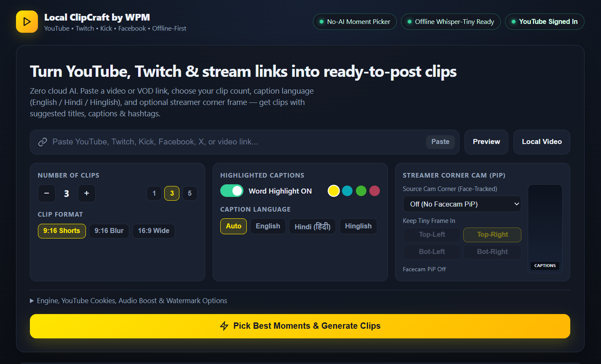
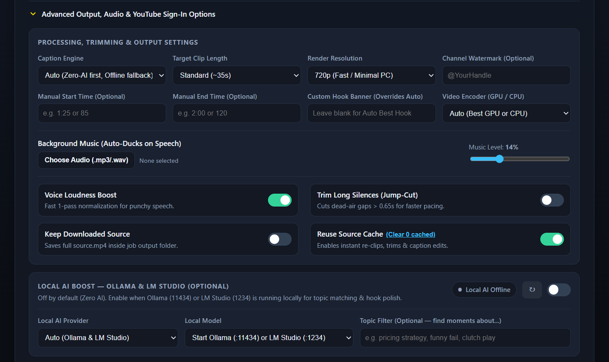
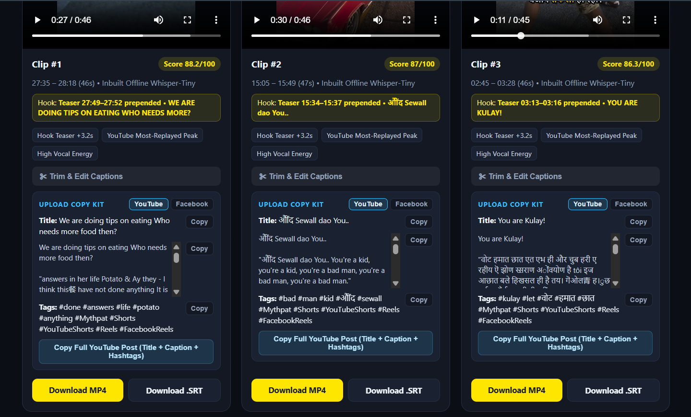

<div align="center">
  
  <h1>Local ClipCraft by WPM</h1>
  <p>
    <strong>Turn long YouTube, Twitch, Kick &amp; Facebook videos into viral short clips with word-by-word highlighted captions — 100% locally on your own computer!</strong>
  </p>
  <p>
    No paid APIs • No cloud AI keys • Works on minimal PCs • Universal Human-Face Cam Frame • English, Hindi &amp; Hinglish Captions
  </p>
</div>

---



## ✨ What Can This Tool Do?

- **Zero-Cloud Moment Picker (No AI Needed!)**: Automatically finds the best, funniest, and most exciting parts of any long video using:
  - YouTube's **"Most Replayed"** audience heatmap
  - **Audio Energy & Speech Peaks** (loud reactions, excitement, laughter)
  - **Smart Hook Detection** (questions, exclamations, catchy lines)
  - **Clean Pause Cutting** (never cuts off mid-word!)
- **Word-by-Word Highlighted Captions**:
  - Uses existing YouTube captions first (**0% AI!**), or falls back to an **inbuilt tiny offline speech model** (`faster-whisper-tiny`, CPU-friendly) only when a video has no captions.
  - Supports **Auto**, **English**, **Hindi (`हिंदी`)**, and **Hinglish**!
- **Universal Real-Human Streamer Cam Frame (PiP)**:
  - Automatically finds the **real human streamer face anywhere in the source video** (top/bottom corners, top-center, bottom-center, mid-left/mid-right edges, center, or floating cams — while filtering out in-game NPCs and static posters!).
  - Smoothly tracks their head and fits them cleanly edge-to-edge into your Cam Frame corner with **no blurry dead bars**, keeps gameplay centered, and automatically hides the Cam Frame during cutscenes.
- **Works With 1,000+ Sites & Local Videos**:
  - Paste links from **YouTube**, **Twitch**, **Kick**, **Facebook**, **X / Twitter**, **Instagram**, **TikTok**, **Vimeo**, **Rumble**, or upload a **Local Video** directly from your PC.
- **Pre-Edited Reel Captioner**:
  - Already edited your reel? Upload it in the **Caption Your Pre-Edited Reel** section to burn highlighted captions onto the full video without slicing it (supports offline transcription or your own pasted script / `.SRT`!).
- **Ready-to-Post Upload Copy Kit**:
  - Generates a **Title**, **YouTube Shorts / Facebook Reels Caption**, and **Hashtags** for every single clip with 1-click **Copy** buttons and **Download All (.ZIP)**.

---

## 📸 Screenshots

| Options, Streamer Cam Frame & 1-Click YouTube Sign-In | Pre-Edited Reel Captioner & Recent Exports |
| :---: | :---: |
|  |  |

| Face-Tracked 9:16 Clips with Cam Frame | Copy-Paste Titles, Captions & Hashtags |
| :---: | :---: |
|  |  |

---

## ⚡ Super Easy 1-Command Setup (Beginner Friendly!)

You do **not** need to be a programmer to run this. Just follow these 2 tiny steps on **Windows 10 / 11**!

### Option 1: Double-Click Setup (No Typing Needed!)

1. **Download this project**:
   - Click the green **`Code`** button at the top of [WorldPixelMap/ClipCraft-by-WPM](https://github.com/WorldPixelMap/ClipCraft-by-WPM) → click **`Download ZIP`**.
   - Right-click the ZIP file → **Extract All...** anywhere (for example `C:\ClipCraft`).
2. **Double-click `start.bat`** inside the extracted folder!
   - On the very first run, `start.bat` automatically runs **`install.bat`** to install **FFmpeg**, **Node.js**, **Python 3.12**, create `.venv`, and install all packages from [`requirements.txt`](requirements.txt) for you!
   - Once finished, your browser opens **`http://127.0.0.1:8000`** automatically!

---

### Option 2: 1-Command Setup in Terminal

Open **PowerShell** / **Command Prompt** (Windows) or **Terminal** (macOS / Linux) inside the project folder and run **one single command**:

**Clone + open folder (if using Git):**
```bash
git clone https://github.com/WorldPixelMap/ClipCraft-by-WPM.git
cd ClipCraft-by-WPM
```

**Install EVERYTHING in 1 command (Windows, macOS & Linux):**
- **Windows (PowerShell or CMD):**
  ```powershell
  .\install.bat
  ```
- **macOS & Linux:**
  ```bash
  bash install.bat
  ```
*(The single `install.bat` installer automatically works on **Windows, macOS, and Linux** — checking/installing **FFmpeg**, **Node.js**, **Python 3.12**, creating `.venv`, installing every package inside [`requirements.txt`](requirements.txt), and caching the lightweight face tracker! Wait 1–2 minutes the first time.)*

**Start the app:**
- **Windows:** Double-click `start.bat` (or run `.\start.bat`)
- **macOS / Linux:** `.venv/bin/python run.py` then open **`http://127.0.0.1:8000`**

---

<details>
<summary><strong>Manual `requirements.txt` Install (Optional — Click to expand)</strong></summary>

If you already have FFmpeg, Node.js, and Python 3.11–3.13 installed:
```bash
pip install -r requirements.txt
python run.py
```

</details>

> **Note on First Clip:** The very first time a video has no subtitles and falls back to offline transcription, the app automatically downloads and caches `faster-whisper-tiny` (~75 MB) inside `models/`. After that, everything works completely offline!

---

## 🎮 How to Use It (Step-by-Step)

### Option A: Auto-Clip Any YouTube, Twitch, or Stream Video
1. **Paste a Link**: Copy any YouTube, Twitch, Kick, or Facebook video link and paste it into the link box (or click **Preview** to inspect it first).
   - *Don't want to paste a link?* Click **Local Video** next to Preview to pick a video already saved on your computer!
2. **Choose How Many Clips**: Use the **− / +** buttons (or click **1**, **3**, or **5**) to choose how many clips you want.
3. **Choose Format & Captions**:
   - **Clip Format**: Pick `9:16 Shorts`, `9:16 Blur` (great for tutorials), or `16:9 Wide`.
   - **Highlighted Captions**: Keep **Word Highlight ON**, pick your highlight color (Yellow, Cyan, Lime, or Coral), and pick your **Caption Language** (`Auto`, `English`, `Hindi`, or `Hinglish`).
4. **Optional — Streamer Cam Frame (PiP)**:
   - Clipping a gaming stream or reaction video? Under **Detect Real Human Face From**, pick **`Auto-Detect Real Face (Anywhere — Recommended)`** — or choose a specific area (`Top-Left`, `Top-Right`, `Bottom-Left`, `Bottom-Right`, `Top-Center`, `Bottom-Center`, `Mid-Left`, `Mid-Right`, or `Center`) — then pick which corner under **Place Cam Frame In**!
5. **Click the Big Yellow Button**: Click **Pick Best Moments & Generate Clips**. Live progress and generated clips appear directly underneath!
6. **Preview, Copy & Download**:
   - Watch your clips directly in the browser.
   - Switch between **YouTube** and **Facebook** inside **Upload Copy Kit** and click **Copy Full Post** to copy the title, caption, and hashtags in one click.
   - Click **Download MP4**, **Download .SRT**, or **Download All (.ZIP)** at the top!

---

### Option B: Add Highlighted Captions to a Pre-Edited Reel
1. Scroll down to **Caption Your Pre-Edited Reel**.
2. Drag & drop (or click to browse) your already-edited `.mp4` / `.mov` / `.mkv` / `.webm` reel.
3. Choose **Caption Language** (`Auto`, `English`, `Hindi`, or `Hinglish`), **Highlight Color**, and **Reel Size** (`Keep Original` keeps your exact edit untouched!).
4. *(Optional)* Open **Optional: Paste Custom Script / .SRT** to paste your own script for **100% Zero-AI** caption syncing, or add an `@YourHandle` watermark.
5. Click **Add Highlighted Captions to Reel** and download your finished video!

---

## 🔐 Why Might You Need to Sign in to YouTube? (And How It Works)

You do **not** always need to sign in — many videos work immediately without logging in. However, YouTube sometimes asks to verify you are a real person (*"Sign in to confirm you're not a bot"*) because:
- **Anti-Bot & IP Rate Limits:** If several videos are downloaded quickly from your Wi-Fi / ISP IP (or you're using a VPN, shared network, or school/office Wi-Fi), YouTube blocks anonymous downloads until you prove you are signed in.
- **Account-Checked Videos:** Some videos (or high-quality streams) require an active logged-in YouTube session before YouTube allows fetching the video and subtitles.
- **100% Private & Local:** When you sign in, you log in directly on Google's official sign-in page inside an isolated popup window. **Local ClipCraft by WPM never sees or saves your password** — it only saves your temporary session cookies locally on your own computer in `cookies.txt` (ignored by Git), and you can click **Sign Out** anytime to delete them.

### How to Sign In (1 Click):
1. Click the **`Sign in to YouTube`** button at the top-right of the app (or inside the error banner if YouTube asks).
2. Sign into your Google/YouTube account normally in the popup browser window.
3. As soon as sign-in finishes, the popup closes automatically, saves `cookies.txt` locally, and the top-right badge turns green (**`YouTube Signed In`**).
4. Paste your YouTube link and click **Pick Best Moments & Generate Clips**!

*(Prefer not to sign in? You can also upload/paste a Netscape `cookies.txt` file, pick Firefox inside Options, clip Twitch/Kick/Facebook links, or click **Local Video** to clip files already on your PC.)*

---

## 📁 Project Structure

```text
├── app/
│   ├── main.py             # FastAPI server, API routes, favicon, ZIP export & SSE stream
│   ├── pipeline.py         # Job manager, single-fetch orchestration & saved history
│   ├── youtube_service.py  # Multi-platform yt-dlp fetcher & json3/vtt subtitle parsers
│   ├── youtube_auth.py     # 1-click isolated YouTube sign-in & cookie exporter
│   ├── moment_detector.py  # 100% Zero-AI highlight ranker (heatmap + audio DSP + hooks)
│   ├── caption_engine.py   # Word-sync engine, Hinglish transliterator & ASS karaoke builder
│   ├── face_tracker.py     # Offline CPU YuNet real-human face tracker & box detector
│   ├── video_renderer.py   # FFmpeg reframer, edge-to-edge Cam Frame PiP & caption burner
│   ├── social_suggester.py # Zero-AI Title, Caption & Hashtag generator
│   └── models.py           # Pydantic request/response schemas
├── static/
│   ├── index.html          # Offline-ready dark creator studio UI
│   ├── styles.css          # Custom responsive styling (no external CDN dependencies)
│   └── app.js              # Client logic, live SSE progress & Upload Copy Kit
├── screenshots/            # UI & output previews (1.png – 5.png)
├── tests/
│   └── test_clipper.py     # Automated unit & synthetic pipeline test suite
├── install.bat             # Universal 1-command installer (Windows, macOS & Linux)
├── start.bat               # One-click Windows launcher (auto-installs on first run)
├── run.py                  # Cross-platform Python entrypoint (python run.py)
├── requirements.txt        # Python dependencies
├── pyproject.toml          # Project configuration
├── favicon.png             # Project icon
└── LICENSE                 # Proprietary Use-Only License
```

---

## 🧪 Running Tests (For Developers)

```powershell
.\.venv\Scripts\python.exe -m unittest discover -s tests -v
```

---

## 📄 License

**Proprietary — Use Only (All Rights Reserved).**  
You may only use this tool as provided. Modifying, reselling, redistributing, hosting as a service, or any other use without explicit prior written permission from **World Pixel Map** is strictly prohibited. See [LICENSE](LICENSE) for full terms.

---

## 🙏 Credits & Developer

<div align="center">
  
  <br />
  <strong>Created by <a href="https://worldpixelmap.in/">World Pixel Map</a></strong>
  <br />
  Developer: <strong>HMJSarkar</strong>
  <br /><br />
  <a href="https://worldpixelmap.in/">🌐 Website</a> •
  <a href="https://www.facebook.com/HMJSarkar">📘 Facebook</a> •
  <a href="https://www.instagram.com/hmjsarkar">📸 Instagram</a> •
  <a href="https://github.com/WorldPixelMap">💻 GitHub</a>
</div>
