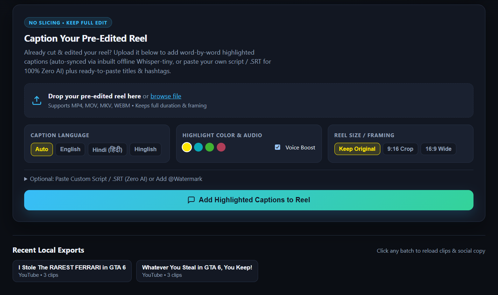
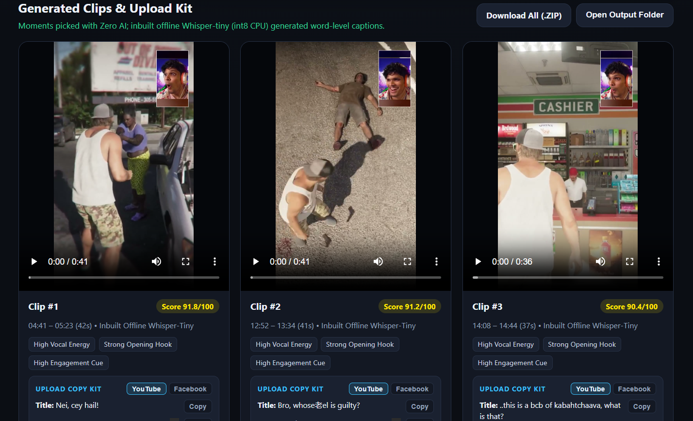

<div align="center">
  
  <h1>Local ClipCraft by WPM</h1>
  <p>
    <strong>Turn long YouTube, Twitch, Kick &amp; Facebook videos into viral short clips with word-by-word highlighted captions — 100% locally on your own computer!</strong>
  </p>
  <p>
    No paid APIs • No cloud AI keys • Works on minimal PCs • Face-tracked Streamer Corner Cam • English, Hindi &amp; Hinglish Captions
  </p>
</div>

---


## ✨ What Can This Tool Do?

- **Zero-Cloud Moment Picker (No AI Needed!)**: Automatically finds the best, funniest, and most exciting parts of any long video using:
  - YouTube's **"Most Replayed"** audience heatmap
  - **Audio Energy & Speech Peaks** (loud reactions, excitement, laughter)
  - **Smart Hook Detection** (questions, exclamations, catchy lines)
  - **Clean Pause Cutting** (never cuts off mid-word!)
- **Word-by-Word Highlighted Captions**:
  - Uses existing YouTube captions first (**0% AI!**), or falls back to an **inbuilt tiny offline speech model** (`faster-whisper-tiny`, CPU-friendly) only when a video has no captions.
  - Supports **Auto**, **English**, **Hindi (`हिंदी`)**, and **Hinglish**!
- **Face-Tracked Streamer Corner Cam (PiP)**:
  - Automatically detects the streamer's face inside their corner webcam, keeps them cleanly framed in a tiny `9:16` corner box, keeps gameplay centered, and automatically hides the corner cam during full-screen cutscenes!
- **Works With 1,000+ Sites & Local Videos**:
  - Paste links from **YouTube**, **Twitch**, **Kick**, **Facebook**, **X / Twitter**, **Instagram**, **TikTok**, **Vimeo**, **Rumble**, or upload a **Local Video** directly from your PC.
- **Pre-Edited Reel Captioner**:
  - Already edited your reel? Upload it in the **Caption Your Pre-Edited Reel** section to burn highlighted captions onto the full video without slicing it (supports offline transcription or your own pasted script / `.SRT`!).
- **Ready-to-Post Upload Copy Kit**:
  - Generates a **Title**, **YouTube Shorts / Facebook Reels Caption**, and **Hashtags** for every single clip with 1-click **Copy** buttons and **Download All (.ZIP)**.

---

## 📸 Screenshots

| Options, Streamer Corner Cam & 1-Click YouTube Sign-In | Pre-Edited Reel Captioner & Recent Exports |
| :---: | :---: |
|  |  |

| Face-Tracked 9:16 Clips with Corner Cam | Copy-Paste Titles, Captions & Hashtags |
| :---: | :---: |
|  |  |

---

## 🧒 Super Easy Setup Guide (Step-by-Step for Beginners!)

Follow these simple steps on **Windows 10 / 11**. Even if you have never coded before, you can get this running in under 5 minutes!

### Step 1: Install 3 Free Tools (One Time Only)

Open **PowerShell** (click the Windows Start menu, type `PowerShell`, and press **Enter**), then copy-paste these 3 commands one by one:

1. **Install Python 3.12**:
   ```powershell
   winget install Python.Python.3.12
   ```
2. **Install FFmpeg** *(used to cut and render videos)*:
   ```powershell
   winget install Gyan.FFmpeg
   ```
3. **Install Node.js** *(helps download YouTube videos smoothly)*:
   ```powershell
   winget install OpenJS.NodeJS.LTS
   ```

> **Tip:** After installing those three, **close PowerShell and open a fresh PowerShell window** so Windows knows about the new commands!

*(Don't have `winget`? You can download them normally from [python.org](https://www.python.org/downloads/), [ffmpeg.org](https://ffmpeg.org/download.html), and [nodejs.org](https://nodejs.org/) — just check **"Add Python to PATH"** during Python setup!)*

---

### Step 2: Download This Project

Either click **Code → Download ZIP** on [GitHub](https://github.com/WorldPixelMap) and unzip it anywhere (for example `C:\ClipCraft`), **or** clone your repository in PowerShell:

```powershell
git clone <your-github-repo-url>
cd <project-folder>
```

*(If you unzipped the folder manually, open PowerShell inside that folder or `cd` into it.)*

---

### Step 3: Create the Virtual Environment & Install Packages

In PowerShell inside the project folder, copy-paste these two lines:

```powershell
python -m venv .venv
.\.venv\Scripts\pip install -r requirements.txt
```

Wait 1–2 minutes while Python installs the required libraries (`fastapi`, `uvicorn`, `yt-dlp`, `faster-whisper`, `opencv-python-headless`, `numpy`, `scipy`, `pysubs2`). You only ever have to do this once!

---

### Step 4: Start the App!

Just **double-click `start.bat`** inside the project folder!

*(Or run it from PowerShell inside the project folder:)*
```powershell
.\.venv\Scripts\python.exe run.py
```

Your browser will automatically open **`http://127.0.0.1:8000`**!

> **Note on First Use:** The first time a video needs the offline speech model (`faster-whisper-tiny`, ~75 MB) or face tracker (`YuNet`, ~227 KB), the app automatically caches them inside the `models/` folder. After that, everything works completely offline!

---

## 🎮 How to Use It (Step-by-Step)

### Option A: Auto-Clip Any YouTube, Twitch, or Stream Video
1. **Paste a Link**: Copy any YouTube, Twitch, Kick, or Facebook video link and paste it into the link box (or click **Preview** to inspect it first).
   - *Don't want to paste a link?* Click **Local Video** next to Preview to pick a video already saved on your computer!
2. **Choose How Many Clips**: Use the **− / +** buttons (or click **1**, **3**, or **5**) to choose how many clips you want.
3. **Choose Format & Captions**:
   - **Clip Format**: Pick `9:16 Shorts`, `9:16 Blur` (great for tutorials), or `16:9 Wide`.
   - **Highlighted Captions**: Keep **Word Highlight ON**, pick your highlight color (Yellow, Cyan, Lime, or Coral), and pick your **Caption Language** (`Auto`, `English`, `Hindi`, or `Hinglish`).
4. **Optional — Streamer Corner Cam (PiP)**:
   - Watching a gaming streamer whose facecam is in a corner? Under **Source Cam Corner (Face-Tracked)**, pick **`Auto-Detect Face Corner (Recommended)`** (or pick their exact corner like `Top-Right of Stream` or `Bottom-Left of Stream`), then choose which corner of your clip you want their tiny `9:16` cam to appear in!
5. **Click the Big Yellow Button**: Click **Pick Best Moments & Generate Clips**.
6. **Preview, Copy & Download**:
   - Watch your clips directly in the browser.
   - Switch between **YouTube** and **Facebook** inside **Upload Copy Kit** and click **Copy Full Post** to copy the title, caption, and hashtags in one click.
   - Click **Download MP4**, **Download .SRT**, or **Download All (.ZIP)** at the top!

---

### Option B: Add Highlighted Captions to a Pre-Edited Reel
1. Scroll down to **Caption Your Pre-Edited Reel**.
2. Drag & drop (or click to browse) your already-edited `.mp4` / `.mov` / `.mkv` / `.webm` reel.
3. Choose **Caption Language** (`Auto`, `English`, `Hindi`, or `Hinglish`), **Highlight Color**, and **Reel Size** (`Keep Original` keeps your exact edit untouched!).
4. *(Optional)* Open **Optional: Paste Custom Script / .SRT** to paste your own script for **100% Zero-AI** caption syncing, or add an `@YourHandle` watermark.
5. Click **Add Highlighted Captions to Reel** and download your finished video!

---

## 🔐 Why Might You Need to Sign in to YouTube? (And How It Works)

You do **not** always need to sign in — many videos work immediately without logging in. However, YouTube sometimes asks to verify you are a real person (*"Sign in to confirm you're not a bot"*) because:
- **Anti-Bot & IP Rate Limits:** If several videos are downloaded quickly from your Wi-Fi / ISP IP (or you're using a VPN, shared network, or school/office Wi-Fi), YouTube blocks anonymous downloads until you prove you are signed in.
- **Account-Checked Videos:** Some videos (or high-quality streams) require an active logged-in YouTube session before YouTube allows fetching the video and subtitles.
- **100% Private & Local:** When you sign in, you log in directly on Google's official sign-in page inside an isolated popup window. **Local ClipCraft by WPM never sees or saves your password** — it only saves your temporary session cookies locally on your own computer in `cookies.txt` (ignored by Git), and you can click **Sign Out** anytime to delete them.

### How to Sign In (1 Click):
1. Click the **`Sign in to YouTube`** button at the top-right of the app (or inside the error banner if YouTube asks).
2. Sign into your Google/YouTube account normally in the popup browser window.
3. As soon as sign-in finishes, the popup closes automatically, saves `cookies.txt` locally, and the top-right badge turns green (**`YouTube Signed In`**).
4. Paste your YouTube link and click **Pick Best Moments & Generate Clips**!

*(Prefer not to sign in? You can also upload/paste a Netscape `cookies.txt` file, pick Firefox inside Options, clip Twitch/Kick/Facebook links, or click **Local Video** to clip files already on your PC.)*

---

## 📁 Project Structure

```text
├── app/
│   ├── main.py             # FastAPI server, API routes, favicon, ZIP export & SSE stream
│   ├── pipeline.py         # Job manager, single-fetch orchestration & saved history
│   ├── youtube_service.py  # Multi-platform yt-dlp fetcher & json3/vtt subtitle parsers
│   ├── youtube_auth.py     # 1-click isolated YouTube sign-in & cookie exporter
│   ├── moment_detector.py  # 100% Zero-AI highlight ranker (heatmap + audio DSP + hooks)
│   ├── caption_engine.py   # Word-sync engine, Hinglish transliterator & ASS karaoke builder
│   ├── face_tracker.py     # Offline CPU YuNet face tracker & webcam border detector
│   ├── video_renderer.py   # FFmpeg reframer, 9:16 corner PiP overlay & caption burner
│   ├── social_suggester.py # Zero-AI Title, Caption & Hashtag generator
│   └── models.py           # Pydantic request/response schemas
├── static/
│   ├── index.html          # Offline-ready dark creator studio UI
│   ├── styles.css          # Custom responsive styling (no external CDN dependencies)
│   └── app.js              # Client logic, live SSE progress & Upload Copy Kit
├── screenshots/            # UI & output previews (1.png – 5.png)
├── tests/
│   └── test_clipper.py     # Automated unit & synthetic pipeline test suite
├── favicon.png             # Project icon
├── start.bat               # One-click Windows launcher
├── run.py                  # Cross-directory Python entrypoint
├── requirements.txt        # Python dependencies
└── pyproject.toml          # Project configuration
```

---

## 🧪 Running Tests (For Developers)

```powershell
.\.venv\Scripts\python.exe -m unittest discover -s tests -v
```

---

## 📄 License

**Proprietary — Use Only (All Rights Reserved).**  
You may only use this tool as provided. Modifying, reselling, redistributing, hosting as a service, or any other use without explicit prior written permission from **World Pixel Map** is strictly prohibited. See [LICENSE](LICENSE) for full terms.

---

## 🙏 Credits & Developer

<div align="center">
  
  <br />
  <strong>Created by <a href="https://worldpixelmap.in/">World Pixel Map</a></strong>
  <br />
  Developer: <strong>HMJSarkar</strong>
  <br /><br />
  <a href="https://worldpixelmap.in/">🌐 Website</a> •
  <a href="https://www.facebook.com/HMJSarkar">📘 Facebook</a> •
  <a href="https://www.instagram.com/hmjsarkar">📸 Instagram</a> •
  <a href="https://github.com/WorldPixelMap">💻 GitHub</a>
</div>
